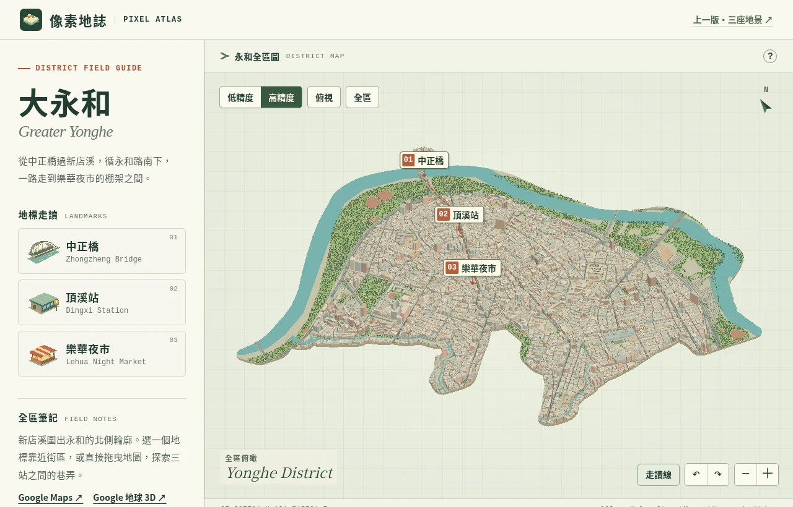

# 大永和 · Yonghe Pixel Atlas

[開啟高精度大永和](https://clarencechien.github.io/pixelartpoc/?quality=fine) · [低精度全區版](https://clarencechien.github.io/pixelartpoc/?quality=low) · [原版三座地景](https://clarencechien.github.io/pixelartpoc/classic.html)

中正橋、捷運頂溪站二號出口、樂華夜市，現在都位在同一張可旋轉的永和地圖。從橋上向南平移，能穿過原本三塊地景之間的街道。走讀線沿道路中心線串起三站，全長約 1.37 公里，供地圖導覽。



## 比較精度

| 版本 | 建物和街景 |
|---|---|
| 高精度全區 | 地圖範圍內 17,305 筆國土測繪中心三維建物衍生輪廓，採資料集的高度欄位，另以 182 筆 OSM 輪廓補充空缺。地面取樣為每像素 1.25 公尺，近看可見水塔、屋頂設備、窗框、車輛及攤棚條紋。 |
| 低精度全區 | 同一區域、同一座標。依 OSM 街道與建物輪廓繪製，缺漏的街屋沿路補繪，高度部分依樓層估計。地面取樣約為每像素 2.5 公尺。 |
| 原版三座地景 | 保留第一版中正橋、頂溪站、樂華夜市的獨立水平切片與互動檢視器。 |

點選地標可移動鏡頭。切換精度時會保留所在位置、角度與縮放。拖曳平移，Shift 加拖曳旋轉，滾輪或雙指縮放。可切換俯視、開關走讀線或回到全區。地圖取得焦點後，可用方向鍵平移、Q/E 旋轉、加減鍵縮放、Home 回全區。各地標附 Google Maps 與 Google 地球 3D 實景連結。

## 本機開啟

```sh
python3 -m http.server 8000 --directory dist
```

開啟 <http://localhost:8000> 即可使用。全區檢視器使用 WebGL 深度測試，讓跨區移動時的橋、街廓、樹木與建物維持正確的前後關係。無法使用 WebGL 時會顯示可平移、縮放的平面備援地圖。原版檢視器採用 [sprite-stacking](https://github.com/danielwh2/sprite-stacking) 的水平切片疊畫方式。兩種檢視器的像素美術均為程式生成。

GitHub Pages 以 `gh-pages` 分支根目錄發布。該分支的檔案對應 `main` 的 `dist/` 目錄。網站不需外部金鑰即可操作。

## 資料來源與示意範圍

- 道路、地標、河道中心線、公園及 OSM 建物來自 © OpenStreetMap contributors，來源快照為 2026-09-16。原始資料和 OSM 衍生幾何依 ODbL 1.0 提供。河寬依中心線近似。[台灣 OSM Parquet 快照](https://huggingface.co/datasets/RhynoWu/taiwan-osm-parquet/tree/91d7c3441abb44deb5ec667915c160d69b712f99) · [OpenStreetMap 版權說明](https://www.openstreetmap.org/copyright)
- 高精度建物取自內政部國土測繪中心三維建物模型的衍生 PMTiles，資料集於 2026-10 擷取。這次裁切的 17,305 筆建物輪廓均標示高度來源為 `reported`。資料集說明列出政府資料開放授權條款第 1 版，也註明 I3S 服務的適用性尚待確認，並請限非商業使用及保留出處。本專案為精度比較原型。像素外牆、窗戶、屋頂設備與攤位外觀屬示意。[資料集與授權說明](https://huggingface.co/datasets/yhzkiki/taiwan-nlsc-buildings/blob/8fc026a49239bb30ca64c8d2097a0adfc4e44c53/README.md)
- 永和區外框取自 `taiwan_basecode` 的鄉鎮市區圖層，另保留河岸與中正橋接岸處。裁切後的邊界與授權文字位於 `tools/city/`。[邊界資料版本](https://github.com/kiang/taiwan_basecode/tree/1bb75f9ba7a81f201c3c5356c486f30bae961d1a/city/geo)

## 重建

全區地圖的座標以永和附近為原點，轉成公尺。程式會重接跨圖磚的建物輪廓，依地理範圍裁切，分開輸出高、低精度建物，共用地理座標、橋體與植栽。小物件只在靠近時繪製。全區地圖所需的靜態檔案已包含於 `dist/city/`。

下載上列 OSM 快照的五個 `elements/part-*.parquet` 及三維建物資料集的 `nlsc-new-taipei.pmtiles`，執行下列指令。

```sh
python3 -m pip install duckdb 'shapely>=2.1' numpy pillow pmtiles mapbox-vector-tile
python3 tools/city/build.py /path/to/elements /path/to/nlsc-new-taipei.pmtiles
```

原版三座地景已有小範圍幾何，執行 `python3 tools/build_art.py` 和 `python3 tools/icons.py` 即可重建。原版可選用 `classic.html` 的 `google-maps-browser-key` 設定 Maps JavaScript API 的網站限制金鑰，以啟用內嵌實景。預設開啟外部 Google 地球。
