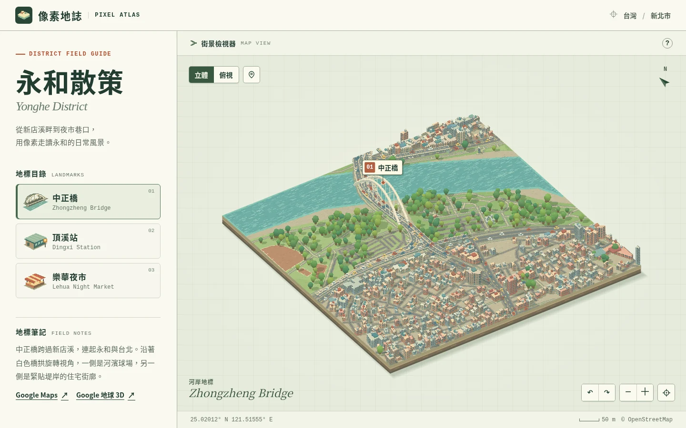

# 永和散策 · Yonghe Pixel Atlas

三個可以旋轉的永和街景模型，從新店溪上的中正橋，到捷運頂溪站二號出口、永平路上的樂華夜市。以 [danielwh2/sprite-stacking](https://github.com/danielwh2/sprite-stacking) 的水平切片渲染方式，將實際地圖幾何轉成像素街景。



## 開啟地圖

使用 Python 3 在 repository 根目錄執行下列指令，開啟 <http://localhost:8000>。所有像素圖層已隨專案提供，不需要安裝 JavaScript 套件或提供金鑰。

```sh
python3 -m http.server 8000 --directory dist
```

- 點選地標切換場景，拖曳旋轉，滾輪或雙指縮放。Shift 加拖曳可平移，手機以雙指平移。
- 可切換俯視、開關標籤、重設視角。將焦點移到地圖後可使用方向鍵、加減鍵與 Home 鍵。
- 地標筆記提供同一地點的 Google Maps 與 Google 地球 3D 連結。

## Google Maps 3D 實景對照

部署者可在 `dist/index.html` 的 `google-maps-browser-key` meta 標籤填入自己網站的瀏覽器金鑰。需啟用 Maps JavaScript API 與帳單，並設定網站來源和 API 限制。設定後，地標筆記會開啟內嵌 Google 3D 地圖，以該地標的經緯度定位。實景涵蓋範圍由 Google 提供。未設定金鑰時，預設開啟 Google 地球。

## 地圖資料與示意範圍

街道、已登錄的建築輪廓、公園和地標座標來自 © OpenStreetMap contributors。地理資料擷取自 [Taiwan OSM tagged elements](https://huggingface.co/datasets/RhynoWu/taiwan-osm-parquet/tree/91d7c3441abb44deb5ec667915c160d69b712f99)，來源快照為 2026-09-16。可再利用的三個場景幾何及其 OSM ID 位於 `tools/geodata/`，依 [ODbL 1.0](https://opendatacommons.org/licenses/odbl/1-0/) 提供。[OpenStreetMap 版權說明](https://www.openstreetmap.org/copyright)

有樓層資料的建物使用資料中的樓層，並略微壓縮高樓以維持街道可見度。缺漏處沿實際街道補畫屋舍。河面寬度依河道中心線近似，橋拱、樹木、店棚、車輛、屋頂與立面使用原創像素造型。像素模型不含 Google 影像或 3D 瓦片。

## 重建切片

`tools/build_art.py` 將每個場景烘焙為由地面到屋頂的透明圖層，再裁切成 PNG 圖集。Canvas 以相同角度旋轉每層、壓縮垂直投影，依高度抬升後用最近鄰取樣疊畫。這些模型直接由地圖幾何產生切片。

```sh
python3 -m pip install numpy pillow
python3 tools/build_art.py
python3 tools/icons.py
```

若要重做地理裁切，下載上述資料集的五個 `elements/part-*.parquet` 檔案，另外安裝 `duckdb`、`shapely>=2`，執行 `python3 tools/extract.py /path/to/elements`，再重建切片。
